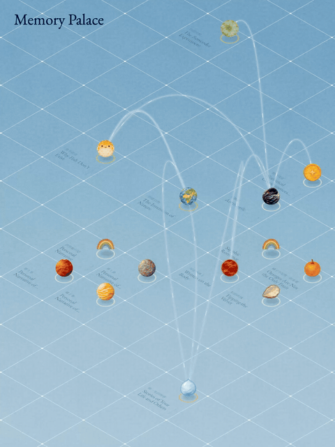

# dsh-palace

[](https://www.npmjs.com/package/dsh-palace)
[](LICENSE)
[](https://github.com/deepseek-ai/deepseek-harness)
[](https://awesome-dsh-plugin.com/)

> Memory Palace：DeepSeek Harness 的读书插件。把书、视频课和笔记放进一座水彩宫殿，你只管记，AI 帮你整理。

<p align="center">
  
  
</p>
<p align="center">
  
  
</p>

装好后，它在 Harness 里显示为 **Memory Palace**（记忆宫殿）。`dsh-palace` 是它在 npm 上的包名，安装时要输入这个名字。

它适合任何「边读边记」的人：读闲书、啃教材、看网课、备考刷题都行。你不用操心怎么分类、怎么排计划，记下来就好，剩下的交给 AI。

## 目录

- [背景](#背景)
- [安装](#安装)
- [使用](#使用)
- [数据存在哪](#数据存在哪)
- [常见问题](#常见问题)
- [维护者](#维护者)
- [参与贡献](#参与贡献)
- [许可证](#许可证)

## 背景

「记忆宫殿」是一种古老的记忆方法：把要记的东西放进脑海里一座房子的各个房间。这个插件把它画成了真的宫殿：

- **宫殿**：每本书、每门视频课、每条笔记各占一格。拖动可以排位置；把一格拖到另一格上，就合成一个分组。每格上的圆环显示读了多少。
- **立体视图**：点右下角「轴测」（或按键盘 `I`），宫殿会立起来，相关的书之间会连上电弧。鼠标停在格子上，能看到它们为什么相关。
- **阅览室**：点开一格，就进入这本书的房间，里面有三页：
  - **进度**：目录、读到哪、目标完成日期。落后了会自动重算每天该读多少。
  - **卡片**：摘录（书里的原话）、想法（你自己的话）、错题（做错的题）。
  - **灵感**：和 AI 聊完这本书，一键把这次对话总结成一篇短文存下来。
- **读书**：EPUB 电子书直接在格子里读，点一个词就能翻译。PDF 用你电脑上的阅读器打开，B 站视频课用浏览器打开，看完回来打勾。
- **AI 对话**：宫殿和每本书都能和 AI 聊（用的就是 Harness 自己的对话）。AI 会记住你读过什么、想过什么，帮你在书和书之间找联系。

## 安装

**你需要**：电脑上装好 DeepSeek Harness 桌面版（0.2.x）。还没有的话，先到 [DeepSeek Harness 官网](https://www.deepseek.com/harness/) 下载安装。

1. 打开 Harness，进入插件安装界面。
2. 输入 `dsh-palace`，点安装。
3. 完全退出 Harness，再重新打开。
4. 左侧导航出现「Memory Palace」，就装好了。

> **用过测试版 `dsh-shelf` 的朋友**：先卸载 `dsh-shelf`，再按上面的步骤安装 `dsh-palace`。你原来的书、笔记和对话会自动保留（数据继续放在原来的 `dsh-shelf-data` 文件夹里），不用重新添加。如果你以前在 `cordis.patch.yml` 里给 `dsh-shelf` 设过 `dataDir`，记得把同样的路径填到 `dsh-palace` 的条目下（见[数据存在哪](#数据存在哪)）。

## 使用

### 第一次打开

有三个入口，打开的是同一座宫殿：

- 左侧导航的「Memory Palace」：全屏打开，看得最清楚；
- 对话标题栏右侧的书本按钮：一边聊天一边看；
- 右侧栏的「Memory Palace」卡片。

### 放进第一本书

1. 点右下角的 **＋**。
2. 选一个文件（PDF 或 EPUB），或者粘贴一个 B 站视频链接，也可以只写一条笔记。
3. 插件只记住文件在哪，**不会复制、也不会改动你的文件**。

### 读书和记笔记

1. 点开一格，进入阅览室。
2. 读完一节，在「进度」里打个勾；鼠标移到某一节点「学到这里」，前面的会一起勾上。
3. 想记点什么，在「卡片」里写下来，或者直接跟 AI 说。
4. 点阅览室左边的 **AI**，和这本书聊聊；聊完点「把这次对话存成灵感」。

### 直接跟 AI 说也行

不想点按钮，可以在对话里直接说：

- 「把 ~/Documents/反脆弱.epub 放进宫殿」
- 「这个视频课加进来：https://www.bilibili.com/video/BV…」
- 「《刑法讲义》的目录在第 5 到 12 页，帮我生成目录」
- 「我 2027 年 9 月考试，帮我把这几本书排一下目标日期」
- 「这本书和《反脆弱》有什么联系？」
- 记错题：把错题截图粘贴到这本书的对话里，说「记错题」。

## 数据存在哪

所有数据都在你自己的电脑上，默认放在 `~/Documents/dsh-palace-data/`（「文稿」文件夹里的 `dsh-palace-data`；用过测试版的是原来的 `dsh-shelf-data`）。都是普通文件，复制这个文件夹就是备份：

- `palace.json`：宫殿里每一格的位置
- `items/`：每一格的目录、进度、卡片和灵感
- `images/`：错题截图
- `memory/`：AI 的记忆（你读过什么、想过什么）

想换个位置存放，可以在 Harness profile 的 `cordis.patch.yml` 里加上：

```yaml
- id: dsh-palace
  name: dsh-palace
  config:
    dataDir: /你想要的/目录
```

## 常见问题

**PDF 没有目录怎么办？**　扫描版 PDF 常常没有目录。进入这本书，在缩略图里勾选目录所在的几页，AI 只读这几页就能生成目录，不用把整本书交给 AI。

**目录或错题识别不出来？**　当前选用的 AI 模型要支持看图。也可以自己截图发给 AI，说「生成《某书》的目录」。

**错题截图没存上？**　截图要直接粘贴在对话里。截图没存上时，题目文字也照样会记下来。

**界面字体需要另外装吗？**　不用。插件自带思源宋体和 EB Garamond。

## 维护者

- [@feolhn](https://github.com/feolhn)：开发
- [@bbhh1226](https://github.com/bbhh1226)：界面与交互设计

## 参与贡献

欢迎提 [Issue](https://github.com/feolhn/dsh-palace/issues) 和 Pull Request，想法和讨论请到 [Discussions](https://github.com/feolhn/dsh-palace/discussions)。

想自己改代码的话：

```sh
pnpm install
pnpm run setup    # 启用提交前的个人信息检查（只需一次）
pnpm build        # 生成 lib/（Host）和 client/（前端）
pnpm test         # 测试（core / host / AI 工具）
pnpm verify       # 合并前跑：类型检查 + 测试 + 个人信息检查 + 构建
```

从源码安装：先 `pnpm build`，再在插件安装界面填仓库文件夹的完整路径。每次改完代码都要重新 `pnpm build`，再重启 Harness。开发说明见 [AGENTS.md](AGENTS.md)，接口约定见 [docs/CONTRACT.md](docs/CONTRACT.md)。

## 许可证

[MIT](LICENSE) © 2026 dsh-palace contributors

内置字体（思源宋体、EB Garamond）使用 [SIL OFL 1.1](vendor/fonts/OFL.txt)。
