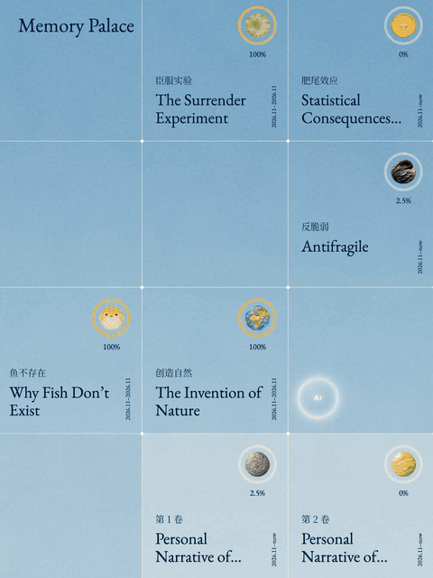
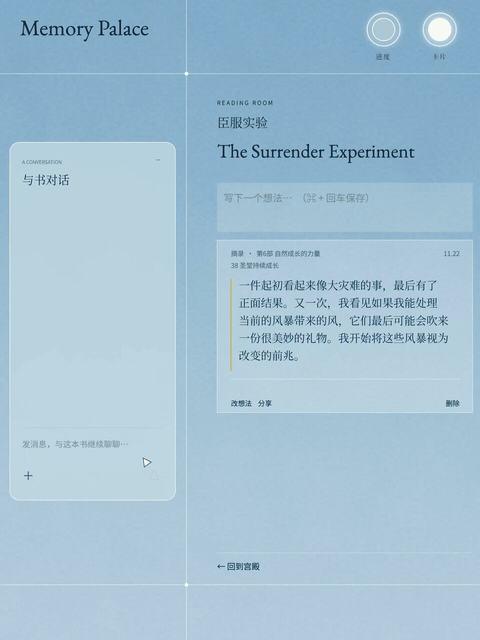
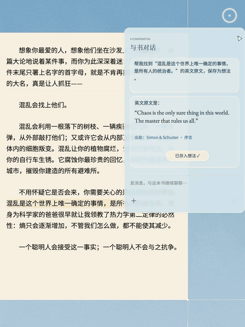

# dsh-palace

[](https://www.npmjs.com/package/dsh-palace)
[](LICENSE)
[](https://github.com/deepseek-ai/deepseek-harness)
[](https://awesome-dsh-plugin.com/)

> Memory Palace：DeepSeek Harness 插件，一个懂你在想什么的 AI。把书、课、剧和随手的念头放进一座宫殿，你只管记、只管聊，AI 帮你整理，也慢慢记住你。

<p align="center">
  
  
</p>
<p align="center">
  
  
</p>

装好后，它在 Harness 里显示为 **Memory Palace**（记忆宫殿）。`dsh-palace` 是它在 npm 上的包名，安装时要输入这个名字。

它适合任何「边看边记」的人：读闲书、啃教材、看网课、备考刷题，追剧、听播客或者只是记下一个念头，也都能放进来。你不用操心怎么分类、怎么排计划，记下来、聊一聊就好，剩下的交给 AI。

## 目录

- [背景](#背景)
- [安装](#安装)
- [使用](#使用)
- [数据存在哪](#数据存在哪)
- [常见问题](#常见问题)
- [维护者](#维护者)
- [参与贡献](#参与贡献)
- [许可证](#许可证)

## 背景

「记忆宫殿」是一种古老的记忆方法：把要记的东西放进脑海里一座房子的各个房间。这个插件把它画成了一座真的宫殿，每样你在意的东西占一格。

和对着空白对话框聊天不同，你是带着一格具体的东西来聊的：一本书、一部剧、一个念头。这样更容易说出真实的想法。聊的过程中，AI 会把值得记住的部分整理成记忆：这一格对你意味着什么、你最近在想什么、哪两格之间有联系。下次你在宫殿里开口，它会接着上次的话题聊。

宫殿里有这些：

- **格子**：一格可以是一条笔记（一个念头、一部剧、一档播客），也可以是一本书或一门 B 站视频课。拖动可以排位置；把一格拖到另一格上，就合成一个分组。
- **阅览室**：点开一格进入。每格都有两页：
  - **卡片**：摘录（原话）、想法（你自己的话）、错题（做错的题）。
  - **灵感**：和 AI 聊完，一键把这次对话总结成一篇短文存下来。
  
  书和视频课还多一页**进度**：目录、看到哪、目标完成日期。落后了会自动重算每天该看多少。
- **AI 对话**：宫殿和每一格都能和 AI 聊，用的就是 Harness 自己的对话。只有宫殿里的对话会带上记忆，你在 Harness 里的其他对话不受影响。
- **立体视图**：点右下角「轴测」（或按键盘 `I`），宫殿会立起来。你和 AI 都认同有联系的两格之间会连上电弧，鼠标停在格子上能看到为什么。
- **读原文**：EPUB 电子书直接在格子里读，点一个词就能翻译。PDF 用你电脑上的阅读器打开，B 站视频课用浏览器打开，看完回来打勾。
- **皮肤**：有水彩和像素两套。点右下角写着「水彩」的按钮就能换，背景、图标、字体一起换，你记下的内容不受影响。

## 安装

**你需要**：电脑上装好 DeepSeek Harness 桌面版（0.2.x）。还没有的话，先到 [DeepSeek Harness 官网](https://www.deepseek.com/harness/) 下载安装。

1. 打开 Harness，进入插件安装界面。
2. 输入 `dsh-palace`，点安装。
3. 完全退出 Harness，再重新打开。
4. 左侧导航出现「Memory Palace」，就装好了。

## 使用

### 打开宫殿

有三个入口，打开的是同一座宫殿：

- 左侧导航的「Memory Palace」：全屏打开，看得最清楚；
- 对话标题栏右侧的书本按钮：一边聊天一边看；
- 右侧栏的「Memory Palace」卡片。

### 从一条想法开始

1. 点右下角的 **＋**，选「笔记」，起个名字，比如你正在追的剧，或者一个念头。
2. 点开这一格，在「卡片」里写下一条想法。
3. 点阅览室左边的 **AI**，和它聊聊这个想法。
4. 聊完点「把这次对话存成灵感」。AI 会顺手把值得记住的部分写进记忆。

以后在宫殿里聊天时，AI 会记得你记过什么、想过什么，也会帮你发现格子之间的联系。

### 放进一本书或一门课

1. 点 **＋**，选「书」，选一个文件（PDF 或 EPUB），或者粘贴一个 B 站视频链接。插件只记住文件在哪，**不会复制、也不会改动你的文件**。
2. 读完一节，在「进度」里打个勾；鼠标移到某一节点「学到这里」，前面的会一起勾上。

### 直接跟 AI 说也行

不想点按钮，可以在对话里直接说：

- 「新建一格，记下我在看的《漫长的季节》，我觉得它讲的是……」
- 「把 ~/Documents/反脆弱.epub 放进宫殿」
- 「这个视频课加进来：https://www.bilibili.com/video/BV…」
- 「这本书和《反脆弱》有什么联系？」
- 「我 2027 年 9 月考试，帮我把这几本书排一下目标日期」
- 记错题：把错题截图粘贴到这本书的对话里，说「记错题」。

## 数据存在哪

所有数据都在你自己的电脑上，默认放在 `~/Documents/dsh-palace-data/`（「文稿」文件夹里的 `dsh-palace-data`）。都是普通文件，复制这个文件夹就是备份：

- `palace.json`：宫殿里每一格的位置
- `items/`：每一格的目录、进度、卡片和灵感
- `images/`：错题截图
- `memory/`：AI 的记忆（你读过什么、想过什么）

想换个位置存放，可以在 Harness profile 的 `cordis.patch.yml` 里加上：

```yaml
- id: dsh-palace
  name: dsh-palace
  config:
    dataDir: /你想要的/目录
```

## 常见问题

**PDF 没有目录怎么办？**　扫描版 PDF 常常没有目录。进入这本书，在缩略图里勾选目录所在的几页，AI 只读这几页就能生成目录，不用把整本书交给 AI。

**目录或错题识别不出来？**　当前选用的 AI 模型要支持看图。也可以自己截图发给 AI，说「生成《某书》的目录」。

**错题截图没存上？**　截图要直接粘贴在对话里。截图没存上时，题目文字也照样会记下来。

**界面字体需要另外装吗？**　不用。插件自带思源宋体和 EB Garamond。

## 维护者

- [@feolhn](https://github.com/feolhn)：开发
- [@bbhh1226](https://github.com/bbhh1226)：界面与交互设计

## 参与贡献

欢迎提 [Issue](https://github.com/feolhn/dsh-palace/issues) 和 Pull Request，想法和讨论请到 [Discussions](https://github.com/feolhn/dsh-palace/discussions)。

想自己改代码的话：

```sh
pnpm install
pnpm run setup    # 启用提交前的个人信息检查（只需一次）
pnpm build        # 生成 lib/（Host）和 client/（前端）
pnpm test         # 测试（core / host / AI 工具）
pnpm verify       # 合并前跑：类型检查 + 测试 + 个人信息检查 + 构建
```

从源码安装：先 `pnpm build`，再在插件安装界面填仓库文件夹的完整路径。每次改完代码都要重新 `pnpm build`，再重启 Harness。开发说明见 [AGENTS.md](AGENTS.md)，接口约定见 [docs/CONTRACT.md](docs/CONTRACT.md)。

## 许可证

[MIT](LICENSE) © 2026 dsh-palace contributors

内置字体（思源宋体、EB Garamond）使用 [SIL OFL 1.1](vendor/fonts/OFL.txt)。
